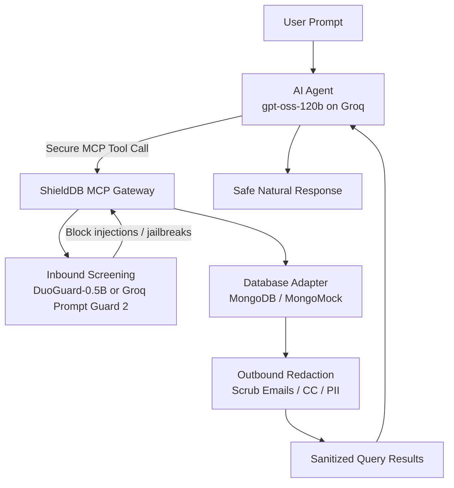

# ShieldDB 🛡️

### The Secured AI Database Workstation & MCP Gateway

[](https://shielddb-dash-82a1b.web.app/)
[](https://vimeo.com/1196684739)
[](LICENSE)
[](https://www.python.org/)

**[🌐 Live Dashboard](https://shielddb-dash-82a1b.web.app/) · [▶ Watch Demo](https://vimeo.com/1196684739)**

---

**ShieldDB** is an enterprise-grade Model Context Protocol (MCP) gateway, security sidecar, and interactive workstation that enables an AI agent to securely administer databases. Powered by **`gpt-oss-120b` on Groq**, the workstation translates plain English instructions into complex database operations. To ensure enterprise compliance and prevent malicious exploits, all agent database interactions are intercepted and audited by **DuoGuard-0.5B** — a state-of-the-art multilingual safety classifier that blocks inbound prompt injections and automatically redacts outbound customer PII. Slim cloud deploys without the local model screen requests with **Llama Prompt Guard 2** and **`gpt-oss-20b`** on Groq instead.

---

## 🌟 Key Features

1. **Autonomous AI Database Workstation 🤖**
   - Employs **`openai/gpt-oss-120b` on Groq** as the primary cognitive engine.
   - Translates complex natural language prompts (e.g., *"Give me a summary of active users in NY and update their status to active"*) into safe, structured database commands via Model Context Protocol (MCP) tool bindings.

2. **Inbound Guardrails (Safety Shielding) 🛡️**
   - Intercepts the agent's incoming instructions to protect database collections against prompt injections, bypass attempts, and destructive command injections.
   - Detects risks across **12 distinct safety categories** (Jailbreak prompts, Non-violent crimes, Violent crimes, Suicide, etc.) in milliseconds.

3. **Outbound Guardrails (PII & Privacy Redaction) 🔒**
   - Automatically sanitizes retrieved query results *before* sending them to the agent or rendering them in the chat workspace.
   - Intelligently redacts Emails, Credit Cards, Social Security Numbers, Phone Numbers, Passwords, and API Keys.
   - Enables full compliance with strict privacy standards like **GDPR, HIPAA, and PCI-DSS**.

4. **Smart Hybrid Database Engine ⚙️**
   - Automatically detects live MongoDB Atlas credentials in the environment.
   - Falls back to an **In-Memory Sandbox (MongoMock)** if offline, pre-seeding it with rich customer records so judges can run and evaluate the system instantly.

5. **Premium Security & Chat Dashboard 💎**
   - Includes the **ShieldDB Agent** workspace — a clean, real-time interactive chat dashboard to instruct the agent in plain English.
   - Features a **Live Security Console & Playground** to test benign vs. malicious prompts and visualize DuoGuard risk profiles and query redactors in real-time.

---

## 🛠️ Architecture



---

## 🚀 Installation & Local Startup

Ensure you have **Python 3.10+** and the **`uv`** package manager installed.

### 0. Environment Setup

To enable the interactive chat agent workspace (and hosted safety screening when the local model isn't installed), set a free Groq API key from [console.groq.com/keys](https://console.groq.com/keys) as an environment variable (or create a `.env` file in the root directory):

```bash
export GROQ_API_KEY="your_groq_api_key_here"
```

### 1. Pre-download Safety Models

To ensure instant startup, pre-cache the DuoGuard weights and tokenizers locally:

```bash
uv run python -m duogaurd_mcp.main download
```

### 2. Start the Security Dashboard & API Backend

Launch the FastAPI REST API serving telemetry and playgrounds:

```bash
uv run python -m duogaurd_mcp.main dashboard
```

*The API will be available at http://localhost:8000.*

### 3. Run the MCP Server (stdio)

To connect ShieldDB to Claude Desktop or Cursor IDE, run:

```bash
uv run python -m duogaurd_mcp.main run
```

---

## 📂 Project Structure

```
duogaurd_mcp/
├── pyproject.toml              # UV dependency metadata
├── README.md                   # System documentation
├── duogaurd_mcp/
│   ├── __init__.py
│   ├── moderator.py            # Safety classification & PII regex redactor
│   ├── database.py             # MongoDB connection & sandbox seed generator
│   ├── server.py               # Secure FastMCP tools
│   ├── api.py                  # FastAPI REST endpoints
│   ├── main.py                 # CLI controller (run, dashboard, download)
│   └── test.py                 # Diagnostic test suite
└── dashboard/                  # React + TypeScript + Vite frontend
```

---

## 🛡️ License

Open-Source under the MIT License. Built for the Google Cloud Rapid Agent Hackathon.